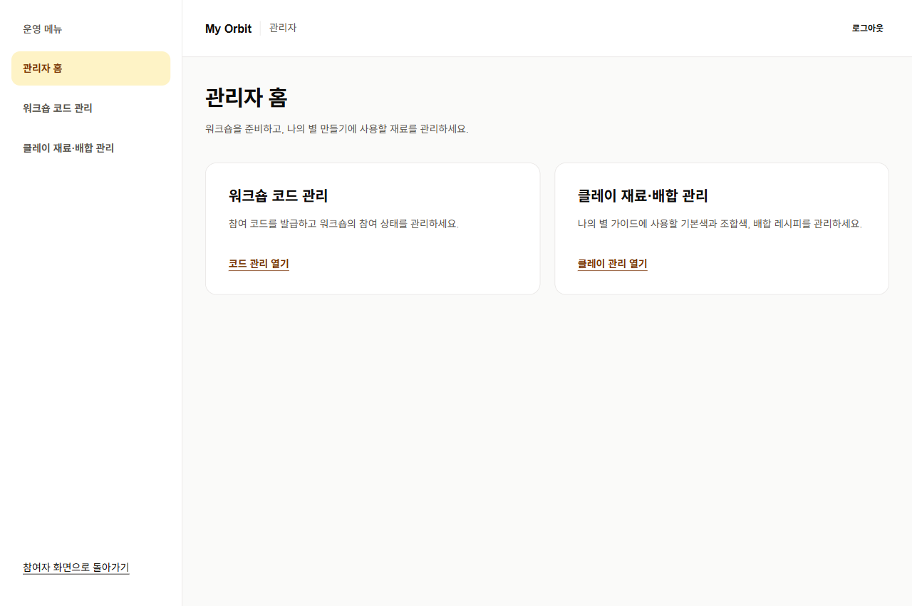
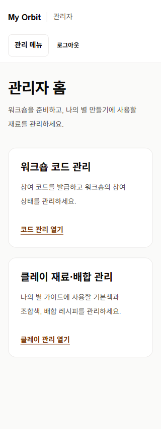
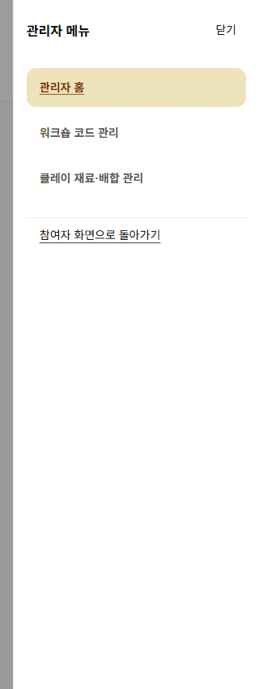

# 관리자 공간 분리 — 2026-11-10

ign8t 작업: `6989372d-278a-4eb3-a891-2c80c876cf5f`

## 구현 범위

- `/admin` 홈에 코드 관리·클레이 관리 진입 카드 추가.
- 기존 `/admin/workshops`, `/admin/clay-materials`를 공통 헤더·메뉴로 통합. `/admin/sessions` 별칭 유지.
- PC 사이드바, 모바일 모달 메뉴, 현재 위치 표시, 키보드 포커스 순환·Escape 닫기·닫은 뒤 버튼으로 포커스 복귀.
- 관리자에게만 참여자 화면에서 관리자 공간 진입 링크 제공. 관리자 화면에서 대시보드 복귀.
- 기존 서버 `requireRole` 및 proxy 권한 검증 유지. API·DB·RLS·OAuth·환경 변수 변경 없음.

## 확인 결과

- `npm run lint` 통과.
- `npm run build -- --webpack` 타입 검사 및 프로덕션 빌드 통과.
- `node --test scripts/test-admin-access.mjs`: 실제 proxy 소스를 사용해 인증·DB 응답만 대체. 비로그인 리다이렉트, 참여자·강사·역할 없음 403, 사용자 메타데이터의 위조 admin 무시, DB admin 허용, DB 오류 차단 확인.
- `node --test scripts/test-database.mjs`: 격리 메모리 DB에서 기존 마이그레이션과 회귀 SQL 통과. 원격 DB 변경 없음.
- 초안·공동 와이파이 제한·참여 코드·이력서 PDF 추출 및 프로필 카드·테마·NFC·vCard 기존 회귀 검사 통과. 실서비스 주소가 필요한 기존 조건부 HTTP 검사 1개는 건너뜀.
- 실제 로컬 프로덕션 서버: 관리자 경로 4개 비로그인 307, 관리자 API 2개 비로그인 401 확인.

## 브라우저 검증 방식과 범위

`scripts/admin-ui-server.mjs`는 실제 관리자 컴포넌트를 별도 테스트 서버로 묶는다. Next 링크·경로 훅만 테스트 어댑터로 대체하며 제품 경로에는 포함되지 않는다. API 요청은 Playwright 테스트 데이터로 응답한다. 인증을 우회하는 제품 코드를 추가하지 않는다.

실행: 프로덕션 빌드 후 `node scripts/admin-ui-server.mjs`. `scripts/verify-admin-ui.mjs`의 `verifyAdminUI(page)`를 Playwright에서 실행한다.

- 1280px·375px·320px에서 가로 넘침, 메뉴 활성 표시, 모바일 열기·닫기·Tab 순환·Escape·복귀 포커스 확인.
- 관리자 진입·대시보드 복귀, 참여자·강사에게 관리자 링크 숨김 확인.
- 코드 목록 빈 상태, 발급·복사·프레젠테이션·종료 UI 확인.
- 기본색 추가·수정·비활성화, 배합 생성·수정, API 실패 후 재시도 UI 확인.
- 테스트 데이터 변경 6회, 실제 원격 데이터 변경 0회.

## 미확인 및 다음 검토

실제 관리자 OAuth 세션으로 코드·재료를 원격 DB에 저장하는 전체 흐름은 이번 검증에 포함하지 않았다. 운영 인증 쿠키를 로컬 주소로 복사하려던 시도는 자동 승인 검토에서 차단됐고 복사하지 않았다. PR Preview에서 직접 로그인 후 관리자 공간 → 코드 관리 → 클레이 관리 → 대시보드 복귀를 확인한다. 실제 데이터 생성·수정은 검증용 항목으로 수행한다.

스펙 예시와 실제 코드의 차이: 사용자 이름은 `users.name`, 클레이 API는 `/api/admin/clay/[[...segments]]`, 권한 헬퍼는 기존 `requireRole`을 사용한다. 비관리자 접근은 기존 403 응답을 유지한다.

## 화면

