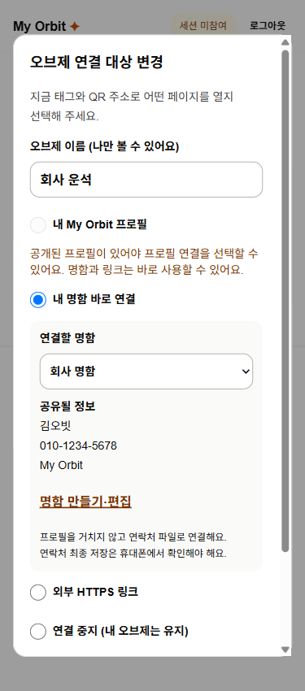
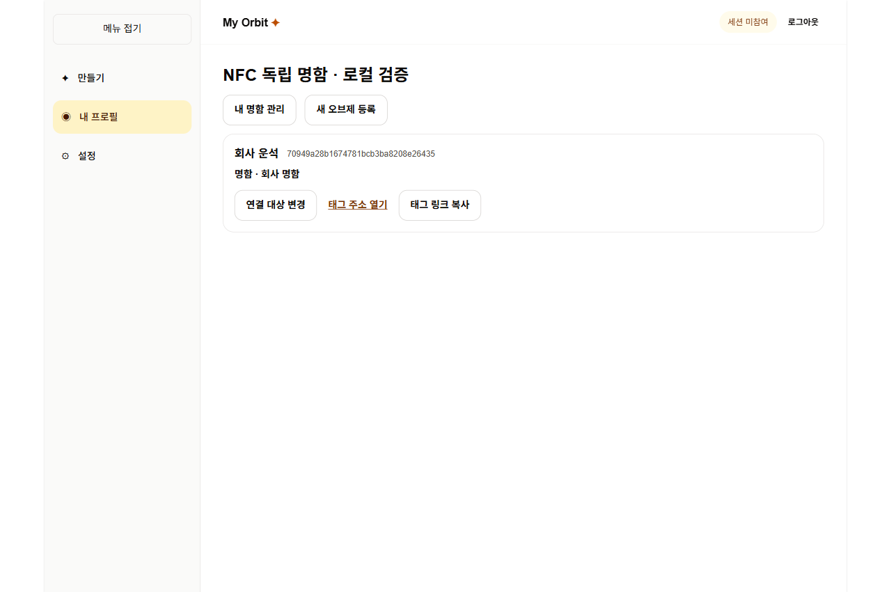

# NFC 오브제별 수동 전환 · 독립 명함

ign8t 작업: `6bb5a712-7e7a-4ee1-96d8-16bea6bdc0d5` / 상세 스펙 `1738a60a-b3dc-43f4-990c-950cddd3b3ae`

## 초안과 생성 스펙 차이 정리

- 생성 스펙의 필수 연락처 안내 페이지 대신, 초안대로 `/t/{tag}/contact`에서 vCard를 직접 제공한다. 기기별 안내 페이지는 실제 휴대폰 검증 후 필요할 때 추가한다.
- 공개 프로필 선택은 **본인의 공개 프로필이 있을 때만** 허용한다. 명함·외부 링크·태그 등록에는 프로필이 필요 없다.
- 생성 SQL 예시의 정책·제약·PK·슬러그 이름은 실제 `nfc_tags_owner_select`, `nfc_tags_owner_destination_update`, `nfc_tags_destination_check`, `tag_id`, `profiles.slug`에 맞춘다.
- ENUM 추가와 새 값 사용은 별도 마이그레이션으로 분리한다. 소유권은 기존 프로필에서 이관하고 기존 목적지는 유지한다. 소유자를 복구할 수 없는 등록 태그는 비활성화한다.
- API는 기존 `/api/tags/{tagId}/destination`을 확장하고 명함 저장·삭제는 `/api/contact-cards`로 제공한다. 임의 필드 직접 업데이트 대신 소유자 검증 RPC를 사용한다.

## 구현한 사용자 흐름

1. 로그인 → 일회용 코드로 오브제 등록. 공개된 프로필이 없어도 등록되며 처음에는 연결 중지다.
2. 대시보드 → 내 명함 관리 → 공개 이름·연락처 등을 직접 입력하고 저장. 로그인 이메일을 자동 복사하지 않는다.
3. 오브제 연결 대상 변경 → 명함 선택 → 공유될 항목 확인·동의 → 저장. 전화번호 또는 이메일 없는 초안 명함은 연결할 수 없다.
4. 비로그인 방문자가 고정 태그 주소를 열면 프로필을 거치지 않고 `.vcf` 파일로 연결한다. 실제 주소록 저장은 기기에서 방문자가 확인한다.
5. 명함 편집은 그 명함을 사용하는 모든 오브제에 반영된다. 개별 오브제의 SNS·명함·공개 프로필·연결 중지는 다른 오브제에 영향을 주지 않는다.
6. 명함 삭제는 연결된 태그를 원자적으로 `none`으로 바꾼다. 이미 받은 파일이나 휴대폰에 저장한 연락처를 회수하지는 못한다.

## DB 적용과 배포

- 새 마이그레이션: `20261110145152_nfc_contact_target_types.sql` → `20261110145157_independent_contact_cards.sql` 순서.
- 새 `contact_cards`: 본인 SELECT RLS만 허용, 생성·수정·삭제는 인증된 소유자 RPC로 제한한다. 익명 테이블 조회 불가.
- 태그 `owner_id`, `card_id`, `alias` 추가. 직접 목적지 UPDATE 권한 제거, 서버 RPC에서 소유권·공개 동의·대상 유효성 검증. 복합 FK로 다른 소유자의 명함 연결을 차단한다.
- 명함 삭제/수정/연결 전환은 계정별 트랜잭션 잠금으로 직렬화한다. 최초 등록의 행 잠금·1회 코드 소비·공동 와이파이 시도 제한은 유지한다.
- 익명 RPC는 활성 태그가 현재 선택한 명함의 공개 필드만 반환한다. 명함 ID로 직접 공개 조회하는 API는 없다. 연락처와 태그 리다이렉트 모두 `no-store`다.
- **공유 원격 DB에는 아직 적용하지 않았다.** 기존 실사용 데이터 변경 0회. 이 저장소는 개발/운영이 같은 Supabase를 쓰므로 PR Preview만 별도 DB라고 가정하면 안 된다.
- 배포 직전 기존 태그 매핑 백업 및 고아 태그 건수 확인 → 두 migration을 각각 커밋하여 적용 → 새 웹 배포 → 로그인/등록/전환 확인 순서다. 기존 웹은 직접 목적지 UPDATE와 프로필 필수 등록 계약을 사용하므로 새 DB와 구버전 웹을 장시간 함께 운영하지 않는다.
- enum 추가만 되돌리려는 파괴적 롤백은 피한다. 두 번째 migration은 트랜잭션 실패 시 전체 롤백된다. 적용 후에는 원본 백업과 신·구 소유권/명함 연결을 비교한 후 별도 수정 migration으로 복구한다. 새 명함 연결을 구버전 profile_id로 임의 변환하지 않는다.
- 환경 변수 추가와 OAuth 복귀 주소 변경은 없다. DB 타입은 새 SQL 계약에 맞춰 갱신했다. Docker가 없어 Supabase CLI 로컬 스택 전체의 타입 재생성은 하지 못했다.

## 확인 결과

- 린트, TypeScript, Next.js 프로덕션 webpack 빌드 통과.
- `node --test scripts/test-database.mjs`: 실제 PostgreSQL 엔진(PGlite)에 전체 migration 적용. 프로필 없는 등록, 복수 태그, 비공개 명함 초안, 전화/이메일 필수 연결, 공유 동의, 명함 수정 전파, 타인 접근 차단, 명함 삭제·태그 비활성·이전 연락처 URL 차단, 프로필 삭제 독립성, 계정 삭제, vCard 개행 주입 차단 확인.
- 기존 태그 데이터가 있는 상태에서 migration을 적용하는 회귀 검사: 기존 공개 프로필/외부 주소·소유권 유지, 고아 태그 비활성화 확인. 기존 저장·공개 및 공동 와이파이 제한 SQL도 통과.
- `scripts/test-nfc-routing.mjs`, `src/modules/public-profile/vcard.test.mjs`: 임시 이동, 캐시 금지, URL 검증, UTF-8 줄 접기·escaping, 독립 명함의 프로필 URL 미포함 확인.
- 로컬 브라우저: 실제 제품 컴포넌트/API 핸들러 + PGlite로 등록 → 명함 생성 → 연결 → 익명 vCard 응답 → 수정 저장·새로고침 → SNS로 변경 → 이전 명함 URL 404 → 다시 명함 연결 → 삭제 후 연결 중지까지 확인.
- 1280·375·320px 가로 넘침 없음. 공개 프로필 없는 경우 해당 선택 비활성, 동의 전 적용 버튼 비활성 확인.

## 로컬 검증 재현과 한계

`node scripts/nfc-ui-server.mjs`로 격리 서버를 시작한 뒤 Playwright에서 `scripts/verify-nfc-ui.mjs`의 `verifyNfcUI(page)`를 실행한다. 서버는 `.env`를 읽지 않으며 원격 Supabase를 호출하지 않는다. 실제 앱 API/컴포넌트/SQL을 쓰되, 인증된 계정 및 Supabase HTTP 전송 계층과 Next 링크·경로 훅은 테스트 어댑터다. 따라서 실제 OAuth 세션부터 시작하는 전체 배포 검증과 동일하다고 주장하지 않는다.

남은 검증: DB 적용 및 Preview 실제 로그인, iPhone 13·Android의 NFC/QR → 연락처 열기 → 저장 확인. 시간별 자동 전환은 이번 범위 밖이다.

